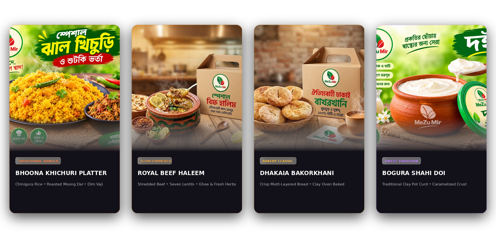

<div align="center">

# 🌿 MEZUMIR — Traditional Bangla Culinary & Food Delivery
### Regional Delicacies & Heritage Feast Ordering Platform Powered by React 19 & Vite 6

[](https://mezumir.pages.dev/)
[](https://react.dev/)
[](https://www.typescriptlang.org/)
[](https://vitejs.dev/)
[](https://tailwindcss.com/)
[](https://mezumir.pages.dev/)
[](LICENSE)

<br/>

**[⚡ View Live Production Deployment](https://mezumir.pages.dev/)** &nbsp;•&nbsp; **[📦 GitHub Repository](https://github.com/labibfohayer/MeZuMir-E-commarce)**

<br/>



</div>

---

## 📌 Architectural Overview

**MeZuMir (মেযুমির)** is a regional culinary and online food ordering platform celebrating the authentic flavors of Bangladesh. From Old Dhaka's slow-simmered Royal Beef Haleem and Shahi Kacchi Biryani to winter date-palm delicacies and clay-pot Bogura Shahi Doi, MeZuMir connects food lovers with pure heritage recipes.

Engineered with **React 19**, **TypeScript**, and **Vite 6**, the platform provides real-time menu categorization, item customization, instant checkout cart calculation, and an integrated administrative dispatch panel.

---

## ⚡ Key Engineering Highlights

1. **Authentic Heritage Menu Matrix:**
   - 4 Curated culinary pillars: Traditional Bhoona Khichuri Platter, Slow-Simmered Royal Haleem, Dhakaia Bakorkhani, and Bogura Shahi Doi.
   - Interactive portion modifiers and special dietary tags (Ghee-Fried, Traditional Clay Pot, Sugar-Free).

2. **Reactive Cart & Order Dispatch Engine:**
   - Client-side checkout flow with dynamic delivery charge calculation and instant order receipt generation.

3. **Ultra-Fast Performance & Optimization:**
   - Zero-delay client transitions built with Vite 6 and hardware-accelerated CSS animations.

---

## 🛠️ Tech Stack & Production Architecture

| Layer | Technologies | Purpose |
| :--- | :--- | :--- |
| **Framework** | React 19, TypeScript, Vite 6 | Rapid development, modular components, optimized bundle |
| **Styling** | Tailwind CSS, Lucide Vector Icons | Responsive culinary layouts with natural earth-tone palettes |
| **State** | React Hooks, Context API | Reactive live bag, quantity increments, promo code logic |
| **Deployment** | Cloudflare Pages, Edge Network | Low-latency static edge delivery worldwide |

---

## 🚀 Getting Started & Local Development

```bash
# Clone the repository
git clone https://github.com/labibfohayer/MeZuMir-E-commarce.git
cd MeZuMir-E-commarce

# Install dependencies
npm install

# Start Vite dev server
npm run dev
```

Open [http://localhost:5173](http://localhost:5173) to view the live store.

---

## 📄 License
This project is open-source and distributed under the [MIT License](LICENSE).
